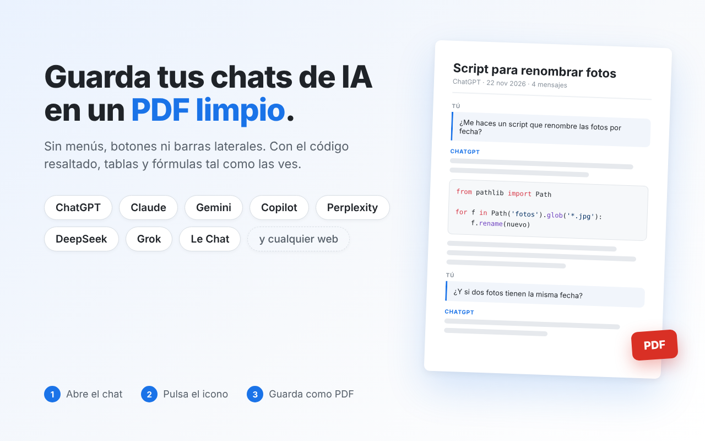

# IA → PDF

Extensión de Chrome para imprimir o guardar en PDF tus conversaciones con cualquier IA, en una vista limpia: sin menús, botones ni barras laterales, con el código resaltado, tablas y fórmulas.



## Funciona con

| Sitio | Soporte |
|---|---|
| ChatGPT (chatgpt.com) | ✅ Probado |
| Claude (claude.ai) | ✅ Probado, incluidas conversaciones largas |
| Gemini (gemini.google.com) | ✅ Probado |
| Copilot, Perplexity, DeepSeek, Grok, Le Chat | 🟡 Adaptador incluido, pendiente de probar a fondo |
| Cualquier otra web | Imprime el contenido principal de la página |

Si tienes **texto seleccionado**, imprime solo la selección, en cualquier web.

Disponible en 15 idiomas: español, inglés, francés, alemán, italiano, portugués (BR y PT), neerlandés, polaco, turco, ruso, japonés, coreano y chino (simplificado y tradicional). Los textos están en `tools/locales.py`; tras editarlos, ejecuta `python3 tools/locales.py`.

## Cómo se usa

Al instalarla se abre una pantalla de bienvenida (en español o inglés, según tu Chrome) que explica estos pasos.

0. **Fija la extensión**: icono de la pieza de puzle de Chrome → chincheta junto a «IA → PDF».
1. Abre la conversación.
2. Pulsa el icono de la extensión o usa **Alt+Shift+P**.
3. Se abre una pestaña con la vista limpia. Ahí puedes:
   - editar el título (haz clic sobre él),
   - ocultar tus mensajes y dejar solo las respuestas,
   - quitar las etiquetas de quién habla,
   - activar el modo compacto o cambiar el tamaño de letra,
   - quitar el crédito «Generado con IA → PDF · gofiodesign.eu» del pie (activado por defecto).
4. Pulsa **Imprimir / Guardar PDF** y elige «Guardar como PDF» como destino.

La extensión recorre la conversación completa antes de imprimir, así que también funciona con chats largos que la web carga a trozos.

## Privacidad

No recoge, envía ni guarda ningún dato. Solo lee la pestaña en el momento en que pulsas el icono, y todo se procesa en tu navegador. Consulta la [política de privacidad](PRIVACY.md).

## Descarga

Paquete listo para la Chrome Web Store o para instalar a mano: [`releases/ai-pdf-2.0.0.zip`](releases/ai-pdf-2.0.0.zip)

## Instalación manual

1. Descarga [`releases/ai-pdf-2.0.0.zip`](releases/ai-pdf-2.0.0.zip) (o el repositorio entero) y descomprímelo.
2. Abre `chrome://extensions` y activa el **Modo de desarrollador**.
3. Pulsa **Cargar descomprimida** y elige la carpeta descomprimida (o la carpeta `extension` si bajaste el repositorio).

## Si una IA deja de funcionar

Las webs de IA cambian a menudo. Si en alguna sale vacío o mal, abre un [issue](https://github.com/GofioDesign/AI-PDF/issues) con el nombre del sitio. Los adaptadores están en `extension/extract.js`.

## Publicar una versión nueva

```bash
./build.sh   # genera dist/ai-pdf-<versión>.zip para la Chrome Web Store
```

## Créditos

Resaltado de código con [highlight.js](https://highlightjs.org/) (licencia BSD-3-Clause).

## Licencia

[MIT](LICENSE) © Gofio Design
